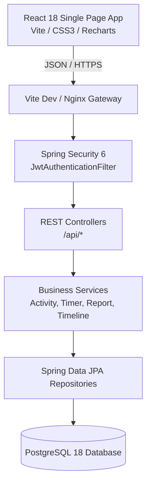

# ChronoTrack – Architecture & System Design

## 1. Architectural Style
ChronoTrack follows a **Layered Monolith Architecture with Decoupled Single-Page Client (SPA)**.
- **Frontend Layer:** React 18 SPA built with Vite, React Router v6, Axios, Recharts, and custom CSS design system.
- **API & Security Layer:** Spring Boot 3 REST Controllers with Spring Security 6, JWT Bearer interceptor, and exception handling.
- **Business Logic Layer:** Stateless Spring Services managing activity rules, overlapping prevention, overnight splitting, and persistent timer calculations.
- **Data Access Layer:** Spring Data JPA with Hibernate ORM mapped to PostgreSQL 18.



---

## 2. Core Design Patterns

### 2.1 Multi-Tenant Data Isolation
Every business record (`Activity`, `Category`, `TimerSession`, `Goal`, `Reminder`, `UserSettings`) is strictly tied to a `user_id`. Queries execute exclusively within the authenticated user's scope:
```java
@Query("SELECT a FROM Activity a WHERE a.user.id = :userId AND a.endTime > :start AND a.startTime < :end ORDER BY a.startTime ASC")
List<Activity> findActivitiesInRange(@Param("userId") Long userId, @Param("start") Instant start, @Param("end") Instant end);
```

### 2.2 Strict Non-Overlapping Invariant
To prevent double-counting of time, the application verifies that no two activities overlap for the same user:
```
New activity [S_new, E_new] overlaps with existing [S_old, E_old] if:
(S_new < E_old) AND (E_new > S_old)
```
When updating an existing activity, the current activity ID is excluded from the check.

### 2.3 Resilient Persistent Real-Time Timer
Instead of holding timer state in browser memory (which is lost on refresh or tab switch), ChronoTrack persists timers to PostgreSQL:
- On `start`: `start_time = now()`, `status = RUNNING`, `accumulated_seconds = 0`.
- On `pause`: `accumulated_seconds += duration(last_resumed_time, now())`, `status = PAUSED`.
- On `resume`: `last_resumed_time = now()`, `status = RUNNING`.
- On `stop`: Total seconds = `accumulated_seconds + (now() - last_resumed_time)`. Automatically creates an `Activity` spanning `[now() - totalSeconds, now()]`.

### 2.4 24-Hour Continuous Timeline & Midnight Boundary Clipping
For any given date `D` in the user's timezone:
- Range is defined as `[D 00:00:00, (D + 1) 00:00:00)`.
- If an activity starts at `22:00` on Day 1 and ends at `06:00` on Day 2:
  - Day 1 timeline displays the segment `[22:00, 24:00]` (120 minutes).
  - Day 2 timeline displays the segment `[00:00, 06:00]` (360 minutes).
- Gaps between `00:00` and `24:00` that have no activity are calculated in O(N) time and exposed as interactive gap blocks.

### 2.5 ISO-8601 Monday-to-Sunday Analytics Engine
Weekly reports strictly align with ISO-8601 standard weeks (Monday 00:00 to Sunday 23:59:59.999). Comparisons against the prior week are calculated as:
$$\Delta\% = \frac{\text{ProductiveTime}_{\text{current}} - \text{ProductiveTime}_{\text{prior}}}{\text{ProductiveTime}_{\text{prior}}} \times 100$$
Zero-division scenarios are safely normalized.
