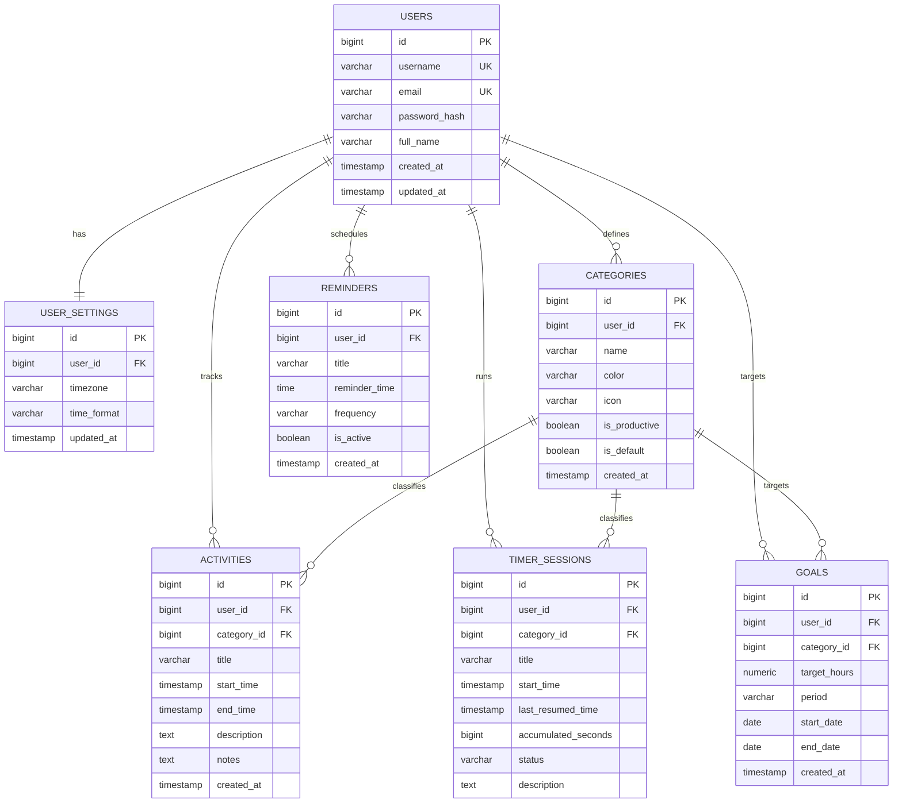

# ChronoTrack – Database Schema Design

## 1. Relational Database Architecture
ChronoTrack utilizes **PostgreSQL 18** for relational persistence, ACID guarantees, and temporal index optimization.

---

## 2. Table Specifications

### 2.1 `users`
| Column | Type | Constraints | Description |
| :--- | :--- | :--- | :--- |
| `id` | `BIGSERIAL` | `PRIMARY KEY` | Unique user identifier |
| `username` | `VARCHAR(50)` | `NOT NULL, UNIQUE` | Unique username for login |
| `email` | `VARCHAR(100)` | `NOT NULL, UNIQUE` | Unique email address |
| `password_hash`| `VARCHAR(255)` | `NOT NULL` | BCrypt password hash |
| `full_name` | `VARCHAR(100)` | `NOT NULL` | Display name |
| `created_at` | `TIMESTAMP` | `NOT NULL, DEFAULT NOW()` | Account creation timestamp |
| `updated_at` | `TIMESTAMP` | `NOT NULL, DEFAULT NOW()` | Last update timestamp |

### 2.2 `user_settings`
| Column | Type | Constraints | Description |
| :--- | :--- | :--- | :--- |
| `id` | `BIGSERIAL` | `PRIMARY KEY` | Primary key |
| `user_id` | `BIGINT` | `NOT NULL, UNIQUE, FK -> users(id)` | Foreign key to user |
| `timezone` | `VARCHAR(50)` | `DEFAULT 'UTC'` | User's preferred IANA timezone |
| `time_format`| `VARCHAR(10)` | `DEFAULT '24h'` | Display format: `12h` or `24h` |

### 2.3 `categories`
| Column | Type | Constraints | Description |
| :--- | :--- | :--- | :--- |
| `id` | `BIGSERIAL` | `PRIMARY KEY` | Primary key |
| `user_id` | `BIGINT` | `NOT NULL, FK -> users(id)` | Multi-tenant user owner |
| `name` | `VARCHAR(50)` | `NOT NULL` | Category name |
| `color` | `VARCHAR(20)` | `NOT NULL` | Hex color code (e.g. `#635BFF`) |
| `icon` | `VARCHAR(50)` | `NULLABLE` | Lucide icon name |
| `is_productive`| `BOOLEAN` | `DEFAULT TRUE` | Analytics productivity flag |
| `is_default` | `BOOLEAN` | `DEFAULT FALSE` | True if auto-seeded at signup |

### 2.4 `activities`
| Column | Type | Constraints | Description |
| :--- | :--- | :--- | :--- |
| `id` | `BIGSERIAL` | `PRIMARY KEY` | Primary key |
| `user_id` | `BIGINT` | `NOT NULL, FK -> users(id)` | Multi-tenant user owner |
| `category_id` | `BIGINT` | `NOT NULL, FK -> categories(id)`| Classification category |
| `title` | `VARCHAR(120)` | `NOT NULL` | Activity summary |
| `start_time` | `TIMESTAMP WITH TIME ZONE` | `NOT NULL` | UTC start timestamp |
| `end_time` | `TIMESTAMP WITH TIME ZONE` | `NOT NULL` | UTC end timestamp |
| `description` | `TEXT` | `NULLABLE` | Detailed description |
| `notes` | `TEXT` | `NULLABLE` | Personal reflections & notes |

### 2.5 `timer_sessions`
| Column | Type | Constraints | Description |
| :--- | :--- | :--- | :--- |
| `id` | `BIGSERIAL` | `PRIMARY KEY` | Primary key |
| `user_id` | `BIGINT` | `NOT NULL, FK -> users(id)` | Multi-tenant user owner |
| `category_id` | `BIGINT` | `NOT NULL, FK -> categories(id)`| Classification category |
| `title` | `VARCHAR(120)` | `NOT NULL` | Task in progress |
| `start_time` | `TIMESTAMP WITH TIME ZONE` | `NOT NULL` | Initial timer start time |
| `last_resumed_time` | `TIMESTAMP WITH TIME ZONE` | `NULLABLE` | Last resume timestamp |
| `accumulated_seconds` | `BIGINT` | `DEFAULT 0` | Elapsed seconds prior to pause |
| `status` | `VARCHAR(20)` | `NOT NULL` | `RUNNING`, `PAUSED`, `STOPPED` |

### 2.6 `goals`
| Column | Type | Constraints | Description |
| :--- | :--- | :--- | :--- |
| `id` | `BIGSERIAL` | `PRIMARY KEY` | Primary key |
| `user_id` | `BIGINT` | `NOT NULL, FK -> users(id)` | Multi-tenant user owner |
| `category_id` | `BIGINT` | `NULLABLE, FK -> categories(id)`| Specific category or null for overall |
| `target_hours`| `DECIMAL(5,2)` | `NOT NULL` | Target hours in period |
| `period` | `VARCHAR(20)` | `NOT NULL` | `WEEKLY` or `MONTHLY` |
| `start_date` | `DATE` | `NOT NULL` | Goal start boundary |
| `end_date` | `DATE` | `NOT NULL` | Goal deadline boundary |

### 2.7 `reminders`
| Column | Type | Constraints | Description |
| :--- | :--- | :--- | :--- |
| `id` | `BIGSERIAL` | `PRIMARY KEY` | Primary key |
| `user_id` | `BIGINT` | `NOT NULL, FK -> users(id)` | Multi-tenant user owner |
| `title` | `VARCHAR(120)` | `NOT NULL` | Reminder text |
| `reminder_time`| `TIME` | `NOT NULL` | Daily trigger time (HH:MM:SS) |
| `frequency` | `VARCHAR(20)` | `DEFAULT 'DAILY'` | Frequency trigger rule |
| `is_active` | `BOOLEAN` | `DEFAULT TRUE` | Active toggle |

---

## 3. Database Indexes for Query Optimization
To ensure real-time query speeds under high load, the following indices are maintained:
- `idx_activities_user_range`: `CREATE INDEX ON activities (user_id, start_time, end_time);`
- `idx_activities_user_category`: `CREATE INDEX ON activities (user_id, category_id);`
- `idx_timer_user_status`: `CREATE INDEX ON timer_sessions (user_id, status);`
- `idx_goals_user_period`: `CREATE INDEX ON goals (user_id, period, start_date, end_date);`
